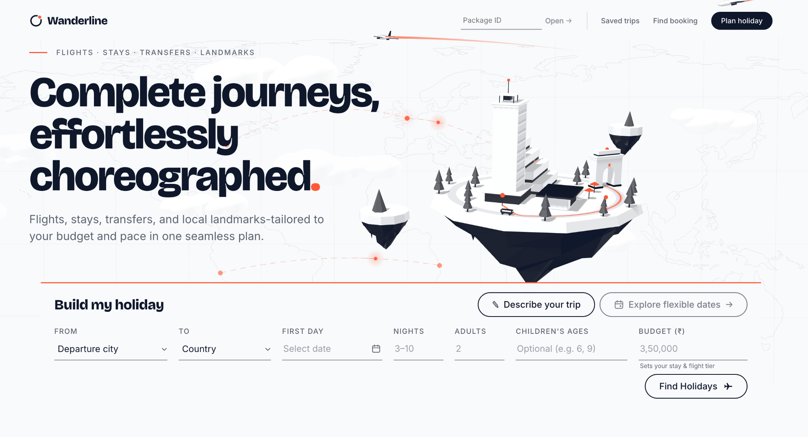

# Wanderline

### Complete journeys, effortlessly choreographed.

**Wanderline** is a constraint-aware holiday planner that brings flights, stays, transfers, and attractions into one connected itinerary. Search in natural language or with a structured form, compare optimized trips, customize the route, and confirm a persistent reservation—all with catalog-backed pricing and validation.

    



## Features

- **Smart trip search:** A rule-based NLP parser extracts departure, destination, arrival date, nights, adults, children's ages, and INR budget from everyday language. Missing or conflicting details can be corrected in the form before searching—no LLM or external AI service is required.
- **Complete itineraries:** Builds valid multi-city holidays with flights, room allocations, airport and intercity transfers, and day-by-day attractions using the provided travel catalog.
- **Three ways to travel (G4):** Compare **Cheapest** (minimum complete-trip cost), **Fastest** (minimum combined flight and intercity-transfer duration), and **Best Rated** (highest night-weighted hotel-star rating within budget).
- **Interactive Explorer's Atlas:** Explore a monochrome country map, click city pins, edit city order and nights, and preview a rebuilt route before applying it.
- **Flexible changes:** Preview and apply flight, hotel, transfer, and attraction changes with dependency checks, itinerary revalidation, and updated pricing.
- **Delay Rescue:** Simulate arrival delays and preview feasible repairs to pickup times and affected activities.
- **Price Landscape:** Browse flexible dates with catalog-derived complete-trip prices, then generate an itinerary for the selected date.
- **Saved trips, confirmation & export:** Reopen planned holidays, confirm a package with a unique 10-digit reference, retrieve it later, and export the itinerary as JSON.

## Quick start

**Requirements:** Python 3.11+, Node.js 18+, and a Bash-compatible terminal.

```bash
# From the project root
./setup.sh
./start.sh
```

Open the frontend URL displayed in the terminal. The setup script installs dependencies; the start script launches the application. No paid maps API or LLM API key is needed.

## Try it

Paste this into **Describe your trip**, or enter the same details in **Build my holiday**:

> Plan a 6-night holiday in Japan from Bangalore starting 10 April 2027 for 2 adults and our 6-year-old child, with a budget of ₹3.5 lakh.

Review the seven extracted fields, then select **Find Holidays**. Compare available packages, choose one, inspect the day-by-day plan, and try changing a hotel or city before confirming.

**Example request:** `BLR → Japan · 10 Apr 2027 · 6 nights · 2 adults · child age 6 · ₹3,50,000`

## How it works

```text
Natural language / seven-field form
                ↓
    Parsing + request validation
                ↓
    Catalog-backed trip planner
                ↓
   Constraints + objective ranking
                ↓
     Complete-trip validation
                ↓
  Compare → Customize → Confirm
                ↓
       SQLite + JSON export
```

The **FastAPI backend** owns planning, pricing, and validation; React renders the interactive experience. It checks flight-seat and room capacity, minimum city stays, directed transfers, airport timing buffers, attraction schedules, and the complete budget. A modification is previewed and revalidated before it is saved; confirmed reservations remain immutable.

Travel inventory and prices come from the supplied JSON catalog, not fabricated bookings or live third-party travel APIs. **Confirmation creates an in-app reservation record; it does not purchase real-world tickets or rooms.**

## Stack

| Layer | Technology |
| --- | --- |
| Frontend | React, Vite, JavaScript/CSS |
| API and planning | Python, FastAPI |
| Persistence | SQLite |
| Travel data | JSON catalog |
| Trip input | Deterministic, rule-based NLP |
| Maps and interactions | SVG-based geographic UI and CSS effects |

## Project layout

```text
assets/            README homepage screenshot
frontend/          React interface
backend/           API, planner, validation, persistence
data/catalog/      Travel inventory and prices
images/            Attraction imagery and attributions
scripts/           Setup checks and export verification
docs/              Architecture and demo notes
setup.sh           Dependency setup
start.sh           Local application startup
```

The homepage preview is stored at `assets/homepage.png`, next to the root `README.md`. Keep both paths unchanged so GitHub displays the image.

See `docs/ARCHITECTURE.md` for the implementation overview, `docs/DEMO.md` for the judging flow, and `images/ATTRIBUTIONS.md` for image credits.

## Verification

The project includes backend/frontend tests, end-to-end flows, and a JSON export checker (`scripts/check_trip_export.py`). Key checks cover itinerary constraints, modification safety, optimizer objectives, reservation persistence, and judge-compatible exports.

## Contributing & license

Bug reports and focused pull requests are welcome through the project's repository. Check for a `LICENSE` file before reusing or redistributing the code; if none is provided, permission is not implied.
